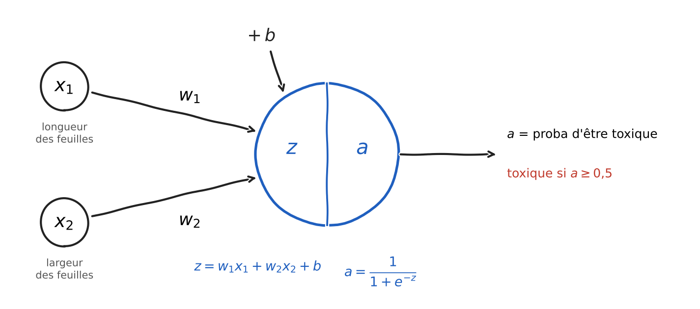
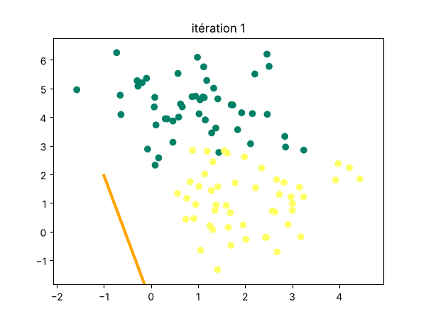

# Un neurone artificiel from scratch

Un neurone artificiel codé uniquement avec NumPy, pour comprendre ce qui se passe à l'intérieur d'un réseau de neurones avant d'utiliser TensorFlow ou PyTorch.

<p align="center"></p>

## Objectif

Prédire si une plante est toxique à partir de deux mesures : la longueur et la largeur de ses feuilles. L'exercice vient de la formation Deep Learning de [Machine Learnia](https://www.youtube.com/@MachineLearnia).

## Démarche

- Jeu de données de 100 plantes en deux classes.
- Modèle : somme pondérée des deux mesures, puis fonction sigmoïde pour obtenir une probabilité.
- Fonction coût : Log Loss.
- Gradients calculés à la main (dérivation en chaîne), puis écrits sous forme matricielle.
- Apprentissage par descente de gradient : 100 itérations, taux d'apprentissage de 0,1.

## Résultats

- **90 %** des plantes correctement classées
- Une nouvelle plante (longueur 2, largeur 1) est classée toxique avec une probabilité de 0,92

<p align="center"><br><em>La frontière de décision se met en place au fil des itérations</em></p>

## Outils

Python, NumPy, Matplotlib, scikit-learn (uniquement pour générer les données)

## Utilisation

Le code et les explications sont dans [`neurone_artificiel.ipynb`](neurone_artificiel.ipynb).

```bash
pip install -r requirements.txt
jupyter notebook neurone_artificiel.ipynb
```
